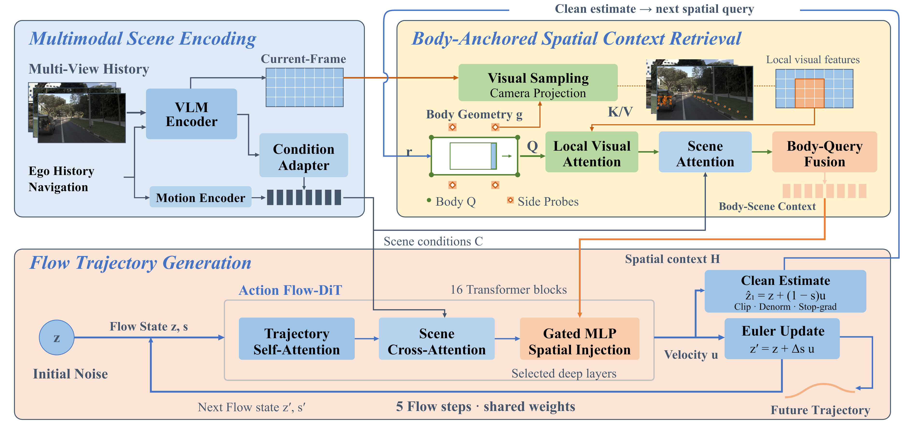
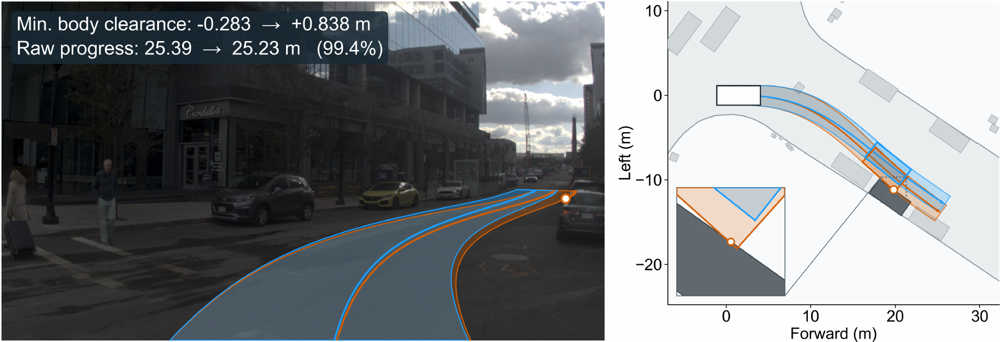
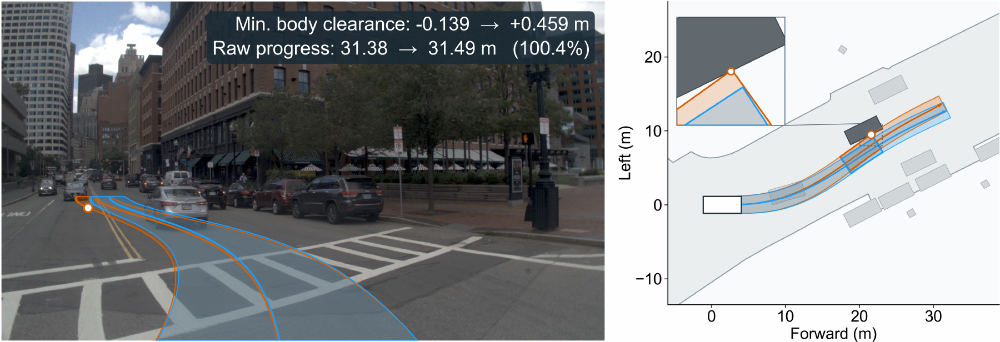
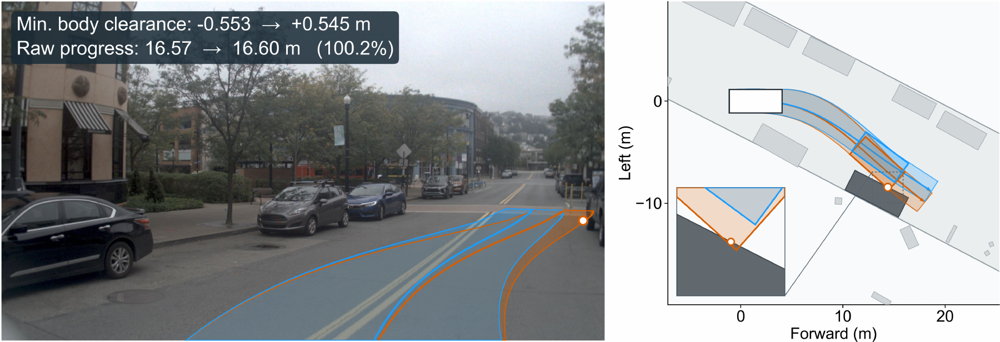
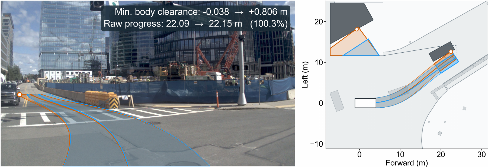
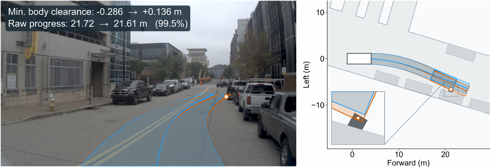
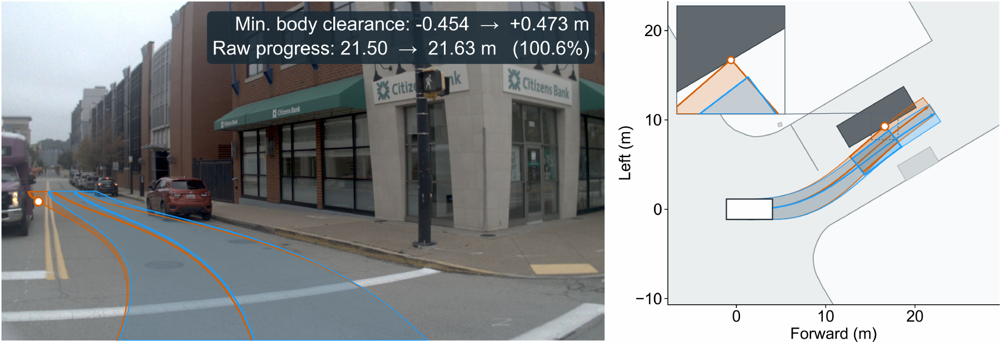

<h1 align="center">FeaXDrive2: Body–Scene Spatial Grounding for Feasibility-Aware Generative Driving</h1>

FeaXDrive2 combines an Alpamayo-conditioned Action Flow-DiT with body-anchored
spatial visual retrieval, rollout-consistent safety fine-tuning (RC-F), and
VLM–Action Alignment. During **five Flow updates**, each preceding clean-trajectory
estimate determines the next body queries and side-probe locations.

<div align="center">
  
</div>

## News

- **2026-11-22**: The formal Fixed-Query Retrieval ablation is supported in RC-F training, checkpoint conversion, and inference.
- **2026-11-20**: Paper-model source code, training objectives, feature readout, checkpoint conversion, and portable examples are released.

## Main Results

Paper results for **FeaXDrive2** on **12,146 NAVTEST scenarios**, using
camera-only perception and single-candidate inference. NAVSIM v2 uses the
official single-stage non-reactive scorer on the same scenarios.
Scores are reported on a 0–100 scale.

| Evaluation | NC ↑ | TTC ↑ | DAC ↑ | EP ↑ | PDMS ↑ | EPDMS ↑ |
| --- | ---: | ---: | ---: | ---: | ---: | ---: |
| NAVSIM v1 | **99.1** | **96.3** | 96.1 | 82.4 | **88.8** | — |
| NAVSIM v2 | **99.1** | **98.6** | 96.1 | 86.9 | — | **88.3** |

NC: no-at-fault collision; TTC: time-to-collision safety; DAC: drivable-area
compliance; EP: ego progress. On NAVSIM v1, at-fault collision scenarios decrease
from **181 to 115** relative to the Base Planner (**36.5% fewer**).

## Installation

Use Python 3.12 for the complete VLM path. Install PyTorch 2.8.0 / torchvision
0.23.0 for your CUDA environment, then run:

```bash
git clone https://github.com/BaoyunWang/FeaXDrive2.git
cd FeaXDrive2
python -m pip install -e ".[test]"
python -m pytest -q
```

For VLM feature extraction and alignment, also install `.[alignment]` and the
[official Alpamayo 1.5 implementation](https://github.com/NVlabs/alpamayo)
(`alpamayo1_5`, Transformers 4.57.1), with its licensed
[model assets](https://huggingface.co/nvidia/Alpamayo-1.5-10B).

## Data and Checkpoints

Prepare local datasets, maps, model weights, and metric caches; these assets
are not included. See the [data contract](docs/data.md) for feature tensors,
camera calibration, scene manifests, and training records.

Convert existing research checkpoints with the exact source-state prefix and
matching model variant:

```bash
python examples/convert_checkpoint.py --kind planner --variant body_scene \
  --prefix agent.action_head. --input /path/to/grounded.ckpt \
  --output checkpoints/body_scene.pt
python examples/convert_checkpoint.py --kind alignment \
  --input /path/to/joint_alignment.pt --output checkpoints/alignment.pt
```

Conversion checks spatial-layout and query-update metadata and tensor shapes.
Inputs use `weights_only=True`; legacy pickled objects require a trusted tensor
export.

## Inference

### Body–Scene Grounded Planner

Run single-candidate inference from a JSONL manifest of cached features:

```bash
python examples/infer.py --manifest /path/to/navtest.jsonl \
  --variant body_scene --checkpoint checkpoints/body_scene.pt \
  --device cuda --output outputs/body_scene_predictions.npz
```

Each trajectory contains eight `(x, y, heading)` poses at 0.5-second intervals
over 4 seconds, in the current ego rear-axle frame (metres/radians). Initial
noise is seeded by scenario token, independently of batch order.

### Full FeaXDrive2

Add the joint-alignment checkpoint and use **features generated by that same
adapted VLM**, with its alignment identity recorded in the manifest:

```bash
python examples/infer.py --manifest /path/to/adapted_navtest.jsonl \
  --variant body_scene --checkpoint checkpoints/body_scene.pt \
  --alignment checkpoints/alignment.pt --device cuda \
  --output outputs/feaxdrive2_predictions.npz
```

See [adapted feature extraction](docs/training.md#adapted-feature-extraction)
for the VLM readout and [data.md](docs/data.md) for feature packing.

## Training

The workflow is **Base Planner learning → offline sample construction → RC-F
→ VLM–Action Alignment**. Keep validation and NAVTEST scenes separate from
training and use validation for checkpoint selection.

The [training guide](docs/training.md) provides commands, sampling and freezing
settings, optimizer configurations, and the formal Fixed-Query Retrieval
ablation. Cached-feature examples use single-device gradient accumulation;
alignment provides model/loss integration. Distributed training, cache
construction, and official model selection remain dataset-side operations.

The released examples have CPU regression checks; a full-data GPU reproduction
of this packaging has not been run.

## Evaluation

Evaluate the token-aligned NPZ predictions with the official
[NAVSIM](https://github.com/autonomousvision/navsim) simulator and matching
v1 or v2 scorer. Wrap each prediction as a NAVSIM `Trajectory` with a 4-second
horizon and 0.5-second interval. The paper's v2 results use the official
single-stage v2 scorer on NAVTEST.

## Code and Documentation

| Component | Implementation |
| --- | --- |
| **Action Flow-DiT**: 16 blocks and five-step Euler generation | [`flow.py`](feaxdrive2/model/flow.py), [`feaxdrive_dit.py`](feaxdrive2/model/feaxdrive_dit.py) |
| **Multimodal condition adapter** | [`conditioning.py`](feaxdrive2/model/conditioning.py), [`multimodal_flow.py`](feaxdrive2/model/multimodal_flow.py) |
| **Body–scene spatial retrieval**: queries, side probes, projection, attention, and gated injection | [`camera_grounded_query.py`](feaxdrive2/model/camera_grounded_query.py) |
| **RC-F**: high-risk supervision and reference behavior preservation | [`rcf.py`](feaxdrive2/training/rcf.py) |
| **Joint VLM–Action Alignment** | [`alignment.py`](feaxdrive2/training/alignment.py), [`alignment_parameters.py`](feaxdrive2/training/alignment_parameters.py) |
| **VLM readout**: native feature extraction, fixed-token training replay, and adapted generation | [`feaxdrive2/vlm/`](feaxdrive2/vlm/) |
| **Local visual-output intervention** | [`local_visual_output_intervention.py`](feaxdrive2/model/local_visual_output_intervention.py) |

- [Feature and training-data contract](docs/data.md)
- [Training, fixed-query ablation, and alignment](docs/training.md)
- [Checkpoint conversion](examples/convert_checkpoint.py)

## Qualitative Results

Body contact avoidance on NAVTEST: **orange** denotes the **Base Planner**, and
**blue** denotes the **Body–Scene Grounded Planner** (spatial retrieval + RC-F,
before VLM–Action Alignment). Each case pairs front-view trajectory and swept-body
overlays with a BEV comparison at the Base Planner's first contact time.
Annotations show minimum signed body clearance and raw progress; percentages
indicate progress retention. Case (e) uses the passenger's annotated footprint.
Click an image to view it at full resolution.

<table>
  <tr>
    <td width="50%" align="center" valign="top">
      <a href="assets/images/case-a.png"></a><br>
      <b>(a) Right turn near another vehicle</b>
    </td>
    <td width="50%" align="center" valign="top">
      <a href="assets/images/case-b.png"></a><br>
      <b>(b) Intersection turn</b>
    </td>
  </tr>
  <tr>
    <td width="50%" align="center" valign="top">
      <a href="assets/images/case-c.png"></a><br>
      <b>(c) Right turn near another vehicle</b>
    </td>
    <td width="50%" align="center" valign="top">
      <a href="assets/images/case-d.png"></a><br>
      <b>(d) Roadworks junction</b>
    </td>
  </tr>
  <tr>
    <td width="50%" align="center" valign="top">
      <a href="assets/images/case-e.png"></a><br>
      <b>(e) Passenger opening a door to exit</b>
    </td>
    <td width="50%" align="center" valign="top">
      <a href="assets/images/case-f.png"></a><br>
      <b>(f) Turning near a long vehicle</b>
    </td>
  </tr>
</table>

## License and Acknowledgements

See [LICENSE](LICENSE) and [NOTICE](NOTICE). Alpamayo and dataset assets remain
subject to their respective licenses. FeaXDrive2 builds on
[FeaXDrive](https://github.com/BaoyunWang/FeaXDrive), NAVSIM,
ReCogDrive/LightningDiT, and NVIDIA Alpamayo.
